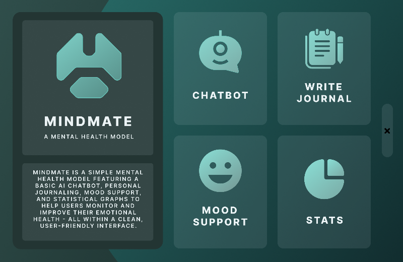

# MindMate

An early desktop side project built with **Python, PyQt6 and Figma**. The screens,
cards and buttons are the original Figma artwork. This update keeps that design
and makes the existing features portable and reliable when run locally.



## Features

- **Journals:** write and save dated UTF-8 text files; open the journal folder from
  the save confirmation or app menu. Unsaved text is protected when closing.
- **Mood support:** select one of five emotions to read the original supportive
  messages. Long messages can scroll. No internet connection is needed.
- **Survey statistics:** browse the original seven survey screens. These are
  survey results, not personal mood tracking or medical assessments.
- **AI chat:** a Gemini conversation with session context, background requests,
  and useful error/retry messages. Internet access and your own API key are needed.

MindMate is a student wellness project, not a clinical tool or a substitute for
professional care.

## Start on Windows from a clone or ZIP

1. Install **64-bit Python 3.12 or 3.13** from [python.org](https://www.python.org/downloads/windows/).
   Include the Python launcher or select **Add Python to PATH** during installation.
   Python 3.10 through 3.14 is supported by the Windows launcher.
2. Clone this repository, or download the ZIP and **extract the complete folder**.
3. Double-click **`Start MindMate.bat`**.

The first launch creates a `.venv` in the project folder and installs the pinned
dependencies. This needs internet access. Later launches reuse that environment.
Keep the launcher console open while the app runs; it displays any setup errors.
There is no separate server or database to set up.

Journals, mood support and survey statistics work immediately. To enable AI chat,
follow the next section.

## Enable the chatbot

1. Get your own key from [Google AI Studio](https://aistudio.google.com/apikey).
2. Open **Chat settings** by pressing **Ctrl+,** or right-clicking inside MindMate.
   Sending your first message without a key also opens this dialog.
3. Paste the key, keep the default model, and click **Save**.

The default model is `gemini-3.5-flash-lite`. The model name is editable in Chat
settings if your account requires another supported model or the provider changes
availability. Saving settings starts a fresh conversation.

Some models have a [limited free tier](https://ai.google.dev/gemini-api/docs/pricing).
Availability and quotas depend on your account and region; the app handles quota
and access errors. You do not need to enable paid billing to use an eligible free
tier. Do not put a shared API key in the repository or executable.

**Chat is online even though the desktop application runs locally.** Only the
messages you send in chat and the current chat session are sent to Gemini. Journal
files and mood-support text are never uploaded automatically. Google's
[data-use terms](https://ai.google.dev/gemini-api/terms) apply, including its free-tier
terms; avoid sending sensitive information you do not want the provider to receive.
Chat history is kept only for the current app session and is not written to disk.

The old integration used GitHub Models, which was [retired in July 2026](https://docs.github.com/en/github-models).
An old GitHub token cannot restore it.

## Local files and controls

On Windows, files are stored separately from the installation:

```text
%LOCALAPPDATA%\MindMate\
    settings.json          # Your API key and model
    Your Journals\
        journal1.txt
        journal2.txt
```

The API key is masked in the settings dialog but stored **unencrypted** in your
local `settings.json`. Do not share that file. Clear the key in Chat settings to
disable AI chat. No credentials or journal entries are bundled in the executable.
Any legacy `Your Journals` folder from the original project is left in place;
new entries use the location above.

| Control | Action |
| --- | --- |
| Original image buttons | Open sections, select emotions, save/send and navigate |
| Enter in the chat input | Send a message |
| Esc | Return home |
| Ctrl+, | Chat settings |
| Ctrl+J | Open the journal folder |
| Ctrl+S on the journal screen | Save the journal |
| Alt+Left / Alt+Right on statistics | Previous / next survey page |
| Right-click | Home, settings, journal folder and survey navigation |

If you close the app during a reply, it finishes the current request before
closing, so its background thread can shut down safely.

## Windows executable

Double-click **`Build Windows App.bat`** to build:

```text
dist\MindMate.exe
```

The executable includes Python, PyQt6, the original images and the Inter font. It
can be copied to another **64-bit Windows** computer and launched directly without
installing Python. Chat still needs the user's own key and internet access.
Build outputs are ignored by Git; share the executable as a GitHub Release asset
rather than committing it into the source tree.

The GitHub Actions **Build Windows app** workflow can also be run manually to
download an executable artifact. It builds and tests the app without API keys.
It does not publish a release automatically.

## Manual launch and development

```powershell
python -m venv .venv
.\.venv\Scripts\python.exe -m pip install -r requirements.txt
.\.venv\Scripts\python.exe MindMate.py
```

Linux/macOS users can use a Python virtual environment and `python MindMate.py`
with the same dependencies. The provided launcher and executable target Windows;
other platforms have not been manually verified. Their files use standard local
application-data locations.

- `MindMate.py` maintains the original fixed 800 x 520 interface and its behaviour.
- `ChatBot_API.py` contains the small Gemini client.
- `app_paths.py` resolves bundled artwork and local settings/journal files.
- `UI_Designer.ui` is the original layout reference with repaired relative paths.
  Do not regenerate `MindMate.py` from it without preserving its custom behaviour:
  the runtime has extra signal wiring and text browsers.
- `Assets/` keeps the original Figma exports and survey graphics.
- `Assets/Fonts/` bundles [Inter](https://github.com/rsms/inter) under its included
  SIL Open Font License.

For optional environment configuration, `GEMINI_API_KEY` and `GEMINI_MODEL` are
read at startup. `MINDMATE_DATA_DIR` overrides local storage for isolated tests.

Run the tests:

```powershell
.\.venv\Scripts\python.exe -m unittest discover -s tests -v
```

The tests exercise navigation, journals/settings, mood text, async chat and API
error handling. API responses are mocked: they do not use real keys, make paid
requests, or read personal journal files. A live chat response still needs to be
checked with your own account/key.

To verify a built executable without opening a window or contacting the API, run
`MindMate.exe --check-install report.json`. It checks bundled images, fonts and
mood buttons, and writes a JSON report plus a home-screen PNG beside it.

If an old credential from the original source is still active, revoke it in your
GitHub account. Removing it from current files does not remove it from old commits.
